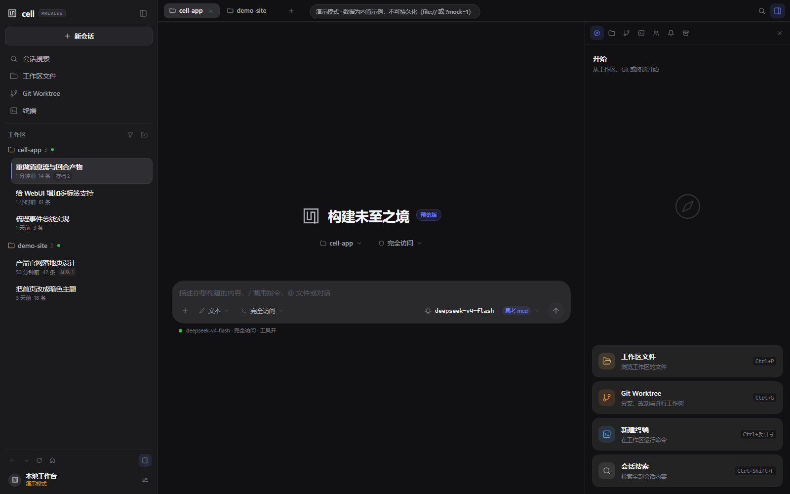
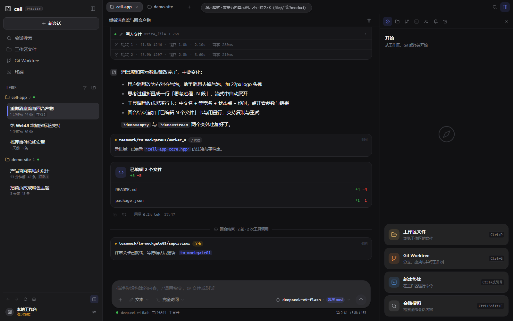
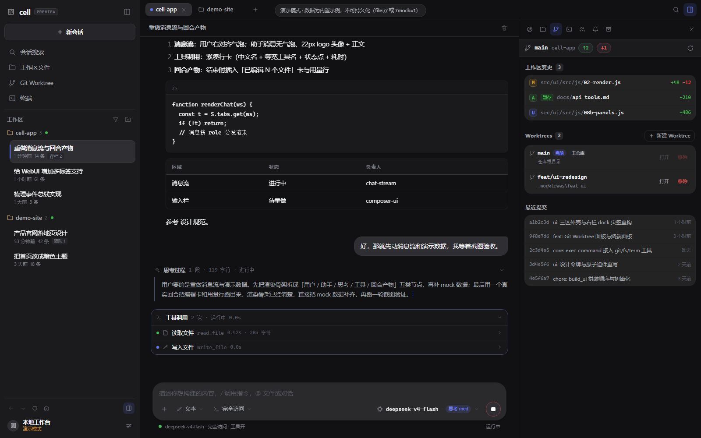
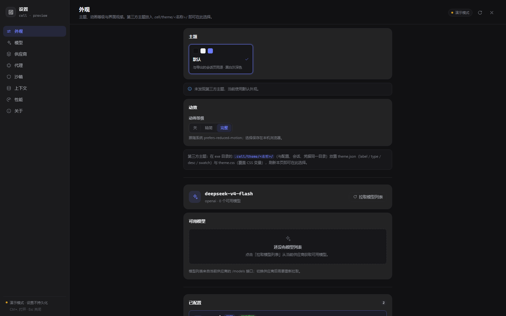
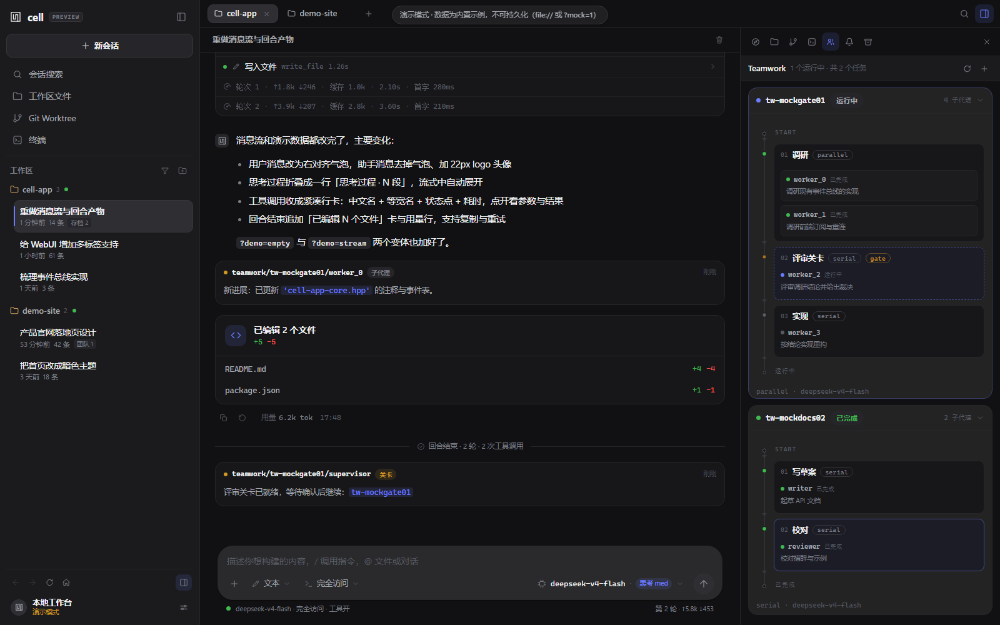

# cell-app — the desktop shell + web service for cell.cpp

One agent runtime, one web UI, several ways to open it:

- **Desktop**: a native window (WebView2 / WebKitGTK / WKWebView) that loads
  the same page a browser gets, served by the built-in HTTP service. On
  Windows, closing the window parks the app in the notification area instead of
  ending it — the tray icon restores it (单击) or offers 显示主窗口 / 退出 (右键),
  so running turns, the HTTP service and notice delivery survive; launching the
  exe again restores the hidden window through the single-instance check.
  `--headless` and the smoke runs are unaffected.
- **Web service**: the UI and API exposed over HTTP on `127.0.0.1` only, so a
  browser, a script or another tool on the same machine can drive the same
  workspaces. Requests must be loopback and same-origin (Host + Origin checks,
  no CORS); there is no LAN/remote access, because the agent has full-access
  tools.
- **Multiple workspaces in parallel**: every working directory gets its own
  engine context (history, turn worker, approvals). Different directories run
  agent turns truly in parallel; within one directory there is exactly one
  working session at a time (use Teamwork to parallelise inside a directory).

```
cell-app.exe                    the desktop app (auto-serves its UI on a free port)
cell-app.exe --serve [PORT]     desktop app + explicit service port (default 8787)
cell-app.exe --headless [PORT]  HTTP service only, no window
cell-app.exe --ui FILE          serve the UI page from disk (dev mode, see below)
```

## Screenshots

| empty state (hero) | a finished turn |
|---|---|
|  |  |

| Git / worktree panel | settings |
|---|---|
|  |  |

| Teamwork flow chart | |
|---|---|
|  | |

All shots are from the self-contained demo mode
(`src/ui/index.html?mock=1`) unless noted; the UI is rebuilt from
`src/ui/src/` by `build_ui.py`.

## Layout

| file | role |
|---|---|
| `CMakeLists.txt` | cross-platform build (regenerates the embedded UI first) — artifacts land in `build/` |
| `src/cell-app.cpp` | entry point: args, window, navigation, JS-bridge fallback, exit guard |
| `src/cell-app-core.hpp` | `app_core`: the **workspace registry** (`workspace_ctx` per directory: history + runner + turn worker + approvals + box state), config/vault, the **command bus** (`exec_command`) and the **event bus** (multi-sink fan-out; every event carries its `ws`) |
| `src/cell-app-http.hpp` | web service: `GET /` (UI), `POST /api/cmd/<name>`, `GET /api/state`, `GET /api/events` (SSE), `GET /api/themes` + `GET /api/theme/<name>` (theme system) |
| `src/cell-app-tools.hpp` | new desktop-tool commands on the same command bus: `git.*` (status/worktrees/branches/log/numstat/diff/init), `fs.*` (list/read/find) and `term.*` (real terminal sessions + `term.exec`) — see *Git worktrees, files and terminal* below |
| `src/ui/src/` | the UI sources: an `index.html` skeleton + `css/*.css` and `js/*.js` layers (vanilla JS + inline CSS, no CDN, no assets). CSS layers run `00-tokens` → `07-motion`; JS layers `00-core` … `09-boot`. Feature panels live in `08b-panels.js` / `08-panels.css`, the composer in `05-composer.js` / `05b-composer.css`, overlays/settings in `06*/07*` |
| `docs/` | `ui-redesign.md` (design tokens, component rules, panel/API contracts) and `api-tools.md` (git/fs/term command reference) |
| `src/ui/index.html` | **generated** — the assembled page, the `--ui` dev-loop artifact |
| `build_ui.py` | assembles `src/ui/src/` into `src/ui/index.html` and embeds it as `src/cell-ui.hpp` |
| `src/cell-ui.hpp` | **generated** — do not edit by hand |
| `assets/` | app icon: `icon.svg` source, `icon.ico`, `icon.rc` (embedded into the exe on Windows) |
| `.cell/theme/<name>/` | third-party UI themes (`theme.json` + `theme.css`) under `<exe dir>/.cell/` — the same root as config/sessions/vault; discovered at runtime, see *Themes* below |
| `cell.cpp/cell.cpp` | the agent core — CLI, `cell::engine`, teamwork, notices, everything else |
| `third_party/include/` | vendored `webview.h` (MIT), `WebView2.h` (BSD-3), `servic.hpp` + `router/router.hpp` (patched, see below) |

## Build

```bash
cmake -B build            # configure (Ninja or Makefiles)
cmake --build build       # → build/cell-app[.exe]
```

On Windows, run CMake from the MSYS2 UCRT64 shell (or point it at the
toolchain: `-DCMAKE_CXX_COMPILER=D:/x64/msys2/ucrt64/bin/g++.exe`). Before
compiling, the build regenerates the embedded UI (`src/ui/src/` →
`src/cell-ui.hpp`) and drops the executable into `build/`.

```bash
cmake -B build -DCELL_STATIC=OFF        # Windows: link against MSYS2 DLLs
cmake -B build -DCELL_CONSOLE=ON        # Windows: keep a console (debugging)
cmake -B build -DCELL_CXX_STANDARD=23   # compilers without -std=c++26
cmake -B build -DPython3_EXECUTABLE=/path/to/python   # interpreter for the UI step
```

## Developing the UI without rebuilding

`src/ui/index.html` is the assembled page and is served straight from disk
when `--ui` is given, so the loop is: edit `src/ui/src/`, rebuild the page,
hit refresh in the browser. No C++ compilation.

```bash
build/cell-app.exe --headless 8787 --ui src/ui/index.html
# open http://127.0.0.1:8787/ , edit src/ui/src/, run `python build_ui.py --html`, refresh
```

The page also works standalone: open `src/ui/index.html` directly in a browser
(`file://`) and it boots in **demo mode** with synthetic data (two
workspaces, a full conversation with reasoning/tool cards/an edited-files
summary, a streaming answer, a teamwork job with a gate, notices, an approval
prompt, mock Git worktrees and a file tree) — useful for design work with no
backend at all. `?mock=1` forces demo mode anywhere; `?demo=empty` shows the
empty *hero* state, `?demo=stream` stops mid-stream, and
`?dock=start|files|git|terminal|teamwork|notices|archives` opens a right-panel
tab on boot. `?settings=1` opens the settings page.

The CMake build runs `build_ui.py` before compiling and only rewrites an
output when its content changed; with `-DCELL_BUILD_UI=OFF` (or no Python
found) the committed `src/cell-ui.hpp` is used unchanged.

## Platform support

| platform | window backend | status | build notes |
|---|---|---|---|
| Windows 10/11 | WebView2 (Edge) | **verified** | MSYS2 UCRT64 g++; statically linked by default — zero third-party DLLs |
| Linux | GTK3 + WebKitGTK | code-complete, not yet tested on hardware | g++ (or clang++); install `gtk+-3.0` + `webkit2gtk-4.1` (fallback `4.0`) dev packages + `libsodium-dev` + `libcurl-dev` |
| macOS | Cocoa + WKWebView | code-complete, not yet tested on hardware | Homebrew LLVM clang++ + static libsodium — libc++ lacks `<generator>` and `std::move_only_function`, so `third_party/compat` backfills both; curl and the Cocoa/WebKit frameworks are system libraries |

**Toolchain floor**: a C++23-capable compiler — GCC 14+ or Clang 17+. The
code uses `std::generator`, `std::expected` and `std::move_only_function`
but no C++26-only features, so `cmake -B build -DCELL_CXX_STANDARD=23`
works on compilers that predate `-std=c++26`. The standard library is the
real gate: libc++ — Apple's and Homebrew LLVM's alike — implements neither
`std::generator` nor `std::move_only_function`, so macOS builds pair
Homebrew LLVM clang++ (needed to parse the Apple SDK headers under
`-std=c++26`) with the `third_party/compat` shims.

**Dependency weight per platform**:
- *Windows*: zero third-party DLLs. TLS via SChannel — no CA bundle needed.
- *Linux*: the GTK/WebKitGTK stack only ships shared, so binaries depend on
  the distro packages; TLS via the distro's ca-certificates.
- *macOS*: system frameworks + system libcurl; only libsodium comes from
  Homebrew. TLS via the system keychain.

Vendored `servic.hpp` carries these patches:
1. query strings are stripped from the routed path (the page reads
   `?theme=` / `?dock=` / `?mock=1` itself);
2. a failed socket write throws instead of being swallowed, so an SSE handler
   can notice a disconnected client;
3. requests run on dedicated, bounded worker threads instead of the io_context
   threads, so a long command or a long-lived SSE stream cannot starve
   accept/read (the desktop shell and every browser tab stay responsive);
4. the listen endpoint is explicit and the shell binds `127.0.0.1` only;
5. the request head is bounded (64 KiB), `Content-Length` is parsed
   case-insensitively and validated, `Transfer-Encoding: chunked` is rejected
   with `411`, and `Expect: 100-continue` is honoured.

## HTTP API (for scripts and integrations)

The service binds `127.0.0.1` only. Every request must carry a loopback
`Host` header (`127.0.0.1:PORT`, `localhost:PORT`) and be same-origin: an
`Origin` from another site, or `Sec-Fetch-Site: cross-site`, is refused with
`403` (request methods are enforced too — anything but the listed one gets
`405`). There is no CORS at all: the page is always served from this same
origin, so no other website can reach the API even from the user's browser.

| method | path | body / notes |
|---|---|---|
| GET | `/` | the single-page UI (or the `--ui` file) |
| POST | `/api/cmd/<name>` | JSON body = command args; JSON result |
| GET | `/api/state` | full snapshot of the active workspace (same as `cmd/state`) |
| GET | `/api/events` | SSE: one `data: {…}` line per agent event |
| — | other methods | `405 Method Not Allowed`; `OPTIONS` is refused as well (no CORS) |

Commands (all return `{"ok":true,...}` or `{"ok":false,"error":"..."}`).
Every command accepts an optional `"ws"` (workspace key); omitted = the
active workspace:

```
workspace.open {cwd}                workspace.close {ws}
workspace.activate {ws}             workspace.list {}

send {ws?, text}                    stop {ws?}
approve {ws?, id, allow}            state {ws?}

settings.get {}                     settings.set {patch}
providers.add {api_style, base, name?, key?, proxy?}
providers.rm {name}                 providers.select {name}
provider.set_key {name, key}        models.fetch {}
model.set {model}

sessions.list {}                    session.select {ws?, id}
session.new {ws?}

teamwork.list {ws?}                 teamwork.report {ws?, job, worker}
teamwork.worker {ws?, job, worker, since?}
teamwork.create {ws?, workflow|list, ...}
teamwork.run {ws?, id}              teamwork.resume {ws?, id}
teamwork.stop {ws?, id}

upload {ws?, name, data_b64}        notice.list {ws?}
notice.clear {ws?}                  notice.send {ws?, session?, body, from?, topic?}

// desktop tools — every one also takes "cwd" (defaults to the ws directory)
git.status {cwd?}                   git.worktrees {cwd?}
git.worktree.add {cwd?, branch, base?, path?, create_branch?}
git.worktree.remove {cwd?, path, force?}
git.branches {cwd?}                 git.log {cwd?, limit?}
git.numstat {cwd?}                  git.diff {cwd?, path?, staged?}
git.init {cwd?}                     fs.list {cwd?, path?}
fs.read {cwd?, path}                fs.find {cwd?, q, limit?}
term.open {cwd?, cols?, rows?, shell?}   term.input {id, data}
term.resize {id, cols, rows}            term.close {id}
term.list                               term.exec {cwd?, cmd, timeout_s?}
```

Full request/response shapes and examples for these are in
[`docs/api-tools.md`](docs/api-tools.md).

`notice.send` delivers a notice to another session. `session` is a handle
resolved against every known session: exact id, unique id prefix, 16-hex
workspace key (→ that group's newest session), a workspace directory path,
`reply`/`@` (→ the newest notice sender that can be answered), or empty
(the caller's own session). The sender is recorded and receivers answer
with the same `reply` handle. A session folder is materialized when the
session becomes live, so a session that has not saved a transcript yet
(fresh GUI workspace, running CLI) is discoverable too — the `session`
field on notice.list rows / SSE notice events is that reply address.

Every event carries `"ws"`; the frontends route it to the right tab.

Example:

```bash
curl -X POST http://127.0.0.1:8787/api/cmd/workspace.open \
     -H "Content-Type: application/json" -d '{"cwd":"D:/work/project"}'

curl -X POST http://127.0.0.1:8787/api/cmd/send \
     -H "Content-Type: application/json" -d '{"ws":"<key>","text":"explain CMakeLists.txt"}'
```

## The UI

The interface follows the same design language as DeepSeek Harness: a
three-column desktop layout over layered dark surfaces, one restrained
indigo accent for interactive states, neutral cards with 1px borders and
generous whitespace. All tokens live in `src/ui/src/css/00-tokens.css`.

- **Left sidebar** — brand, a full-width *新会话* button, quick entries
  (session search, workspace files, Git Worktree, terminal), then sessions
  grouped by workspace with relative time/message counts, worktree and
  teamwork badges. Bottom row: back/forward/refresh/home history, the
  right-panel toggle, connection state and settings. The sidebar is
  resizable and collapsible (`Ctrl+B`).
- **Workspaces as tabs** — one tab per open directory; tabs show a busy
  pulse and unread badges. Background tabs keep accumulating events.
- **Hero empty state** — a centered logo + *构建未至之境* + preview badge,
  the current workspace and sandbox-mode chips, and the floating composer;
  when no workspace is open it becomes an *open a workspace* call to action.
- **Chat** — right-aligned user bubbles, avatar-less assistant prose with a
  22px logo avatar, collapsible reasoning, compact tool rows (policy,
  duration, expandable args/output), per-round token/timing stats, inline
  approvals, block notices and a streaming caret. Auto-follow yields to the
  reader: scrolling up during a stream detaches it and shows a *回到底部*
  button (a new user message or clicking the button re-pins the view). The
  wait indicator shows the real phase — *等待审批 / 正在推理 / 正在输出 /
  正在执行 <tool> / 等待模型响应（第 N 轮）* — with an elapsed timer, instead
  of a single static "thinking" line. When the model creates a Teamwork job
  via the `tw` tool, the call renders as a structured **团队任务已创建**
  card (stages, per-child tasks, model/thinking, gate badges and a jump to
  the panel) instead of raw JSON. Each finished turn ends with an
  **edited-files card** (`已编辑 N 个文件` with `+A/-D` per file, click
  for the diff) and a usage/action footer (`用量 X tok`, copy, retry).
- **Right panel** — a *开始* start page with quick-action cards, plus docked
  tabs for files, Git/Worktree, terminal, Teamwork, notices and archives.
- **Teamwork** — a live flow chart per job (serial/parallel stages, gates,
  active-stage glow); jobs refresh on create/run and whenever gate/job/
  stage/worker progress notices arrive, keeping scroll position and card
  expansion. Failed jobs show the full failure reason in an error block
  (not a truncated pill) plus the failed children; a gate pause renders as
  *等待关卡确认* with run/resume. Clicking a child opens a draggable worker
  window with its assignment, live status/rounds/tool counts, a progress
  timeline from notices and its transcript — a timestamped waiting card is
  shown until the child's first round is persisted, and failures show the
  error and stop polling.
- **Notices** — folded notice cards grouped by sender+topic+path; gate/job
- **Files** — breadcrumb file browser with per-extension icons, a file
  preview overlay (line numbers, markdown rendering, JSON pretty-print,
  binary detection, 5000-line cap) and `Ctrl+P` quick-open across the
  workspace.
- **Git / Worktree** — branch + ahead/behind header, working-tree changes
  with `+A/-D` and per-file diffs, the worktree list (open as workspace /
  remove), a *new worktree* dialog (branch, base, path, create-branch and
  open-after-create toggles; defaults to `<repo>/.worktrees/<branch>` and
  excludes that directory via `.git/info/exclude`) and recent commits.
- **Terminal** — a **real terminal** in the workspace: a persistent shell on a
  pseudoconsole (ConPTY / pty) rendered by an in-page VT emulator, with a block
  cursor, colour, scrollback, Tab completion, arrows/history, Ctrl+C, resize
  (the pty is resized with the panel), copy/paste and IME. One shell per
  workspace survives tab/panel switches, and a page refresh reattaches to the
  same shell and replays its recent output. Dock repaints caused by streaming
  events update the panel in place, so they never take keyboard focus away
  mid-typing. `term.exec` (one-shot commands) remains available on the command
  bus.

- **Notices** — folded notice cards grouped by sender+topic+path; gate/job
  notices are pinned with a one-click *resume*; new notices animate in. The
  panel sends cross-session notices (target handle + body) and every card
  from another session shows a `→ <session>` reply address with an inline
  reply row. An idle session sees notices the moment they land: a backend
  watcher broadcasts them over SSE (~0.7s cadence) without consuming the
  turn-drain pipeline.
- **Composer** — three modes: text, attachments (drag/paste/upload, stored
  under the workspace `.cell/uploads/`), and a structured Teamwork workflow
  builder (stages, gates, per-agent model/thinking) with a "let the LLM
  plan it" path.
- **Slash commands** — `/` opens a fuzzy palette with descriptions and
  context-aware argument hints (sessions of the current workspace, models,
  providers, sandbox modes, jobs, …): `/new /session /model /provider
  /think /tools /sandbox /autoallow /compact /stop /teamwork /notice
  /workspace /theme /git /worktree /files /terminal /help`.
- **Settings page** — providers, model, agent (thinking/tools/system
  prompt), sandbox, compaction, performance limits, theme and animation
  level; everything maps to the same config the CLI writes. Provider/model/
  agent changes are refused while a turn is running (the engine reads that
  config on its worker thread); retry when it finishes. Teamwork jobs are
  unaffected: each job runs on its own snapshot of the settings.
- **Themes & motion** — the built-in look is a layered **deep-dark neutral**
  palette (`#111113` canvas → `#1b1b1d` panels → `#232324` cards → `#2a2a2d`
  composer) with a single indigo accent (`#6c7cff`) reserved for interactive
  and active states; semantic colors (green/red/amber/blue) are used only for
  Git diffs, status and terminal output. Icons are inline SVG throughout (no
  emoji); file-type icons are the only other place color appears. Third-party themes live in the same `.cell`
  directory as config, sessions and the credential vault: drop a folder
  `<exe dir>/.cell/theme/<name>/` with a `theme.json` (`label` / `type` /
  `desc` / `swatch`) and a `theme.css` that redefines the design tokens, then
  pick it in *Settings → 外观* or via `/theme <name>` — no rebuild, no restart
  (the CSS is served with `no-store`). Three
  animation levels and `prefers-reduced-motion` are respected.

One command bus and one event stream feed every client: a desktop window and
several browser tabs can watch and drive the same workspaces, and an approval
answered in one client closes the dialog in the others. Every request (SSE
streams included) runs on its own worker thread, so a long command or several
open tabs can no longer starve the service's accept/read side.

See [`docs/ui-redesign.md`](docs/ui-redesign.md) for the full design system,
component recipes and the panel integration contract.

## Git worktrees, files and terminal

The right panel and the composer's quick cards expose three desktop tools that
share the same command bus as everything else (`src/cell-app-tools.hpp`):

- **Git worktrees** — `git.status` / `git.worktrees` / `git.branches` /
  `git.log` / `git.numstat` / `git.diff` / `git.init` are read-only helpers;
  `git.worktree.add` creates a linked worktree (new or existing branch) and
  `git.worktree.remove` prunes it. Branch names are validated against a safe
  charset and every argument goes through the platform shell runner in
  `cell.cpp`, so a branch name can never break out of the command. A
  worktree created from the UI can be opened as its own workspace/engine
  context, which is the recommended way to run several agents on the same
  repository in parallel (one per branch) — the existing cross-session file
  claims still protect files inside a single worktree.
- **Files** — `fs.list`, `fs.read` and `fs.find` stay inside the workspace
  directory (path traversal is refused), cap previews at 512 KB / 5000 lines
  and serve the quick-open index (Git-ignored build directories are skipped).
- **Terminal** — `term.open` / `term.input` / `term.resize` / `term.close` /
  `term.list` drive a **persistent shell session** on a real pseudoconsole
  (Windows ConPTY, POSIX `forkpty`): output streams over the event bus as
  `term.out` (base64 bytes, rendered by `src/ui/src/js/08c-term.js`), the pty is
  resized with the panel, and a refreshed page reattaches to the same shell and
  replays its recent output. `term.exec` runs a one-shot command in the
  workspace directory with a timeout (default 120 s, `exit_code: 124` on
  timeout), captures stdout and stderr (256 KB cap) and returns duration.

These commands are local-only like the rest of the API: loopback + Host/Origin
checks, no CORS, so they cannot be reached from another website.

## Cross-session file claims

Concurrent workspaces must not interleave edits of the same file. The engine
enforces *first come, first served*: the first session whose writing tools
touch a file claims it; another session's `write`/`edit` on that file is
refused with a clear message ("occupied by another session …"). Reads never
claim and are never refused, and a session's own teamwork children cooperate
rather than conflict. Claims are released automatically when the owning
agent loop ends (turn end / job end), whatever the exit path.

## Smoke tests (no provider needed, isolated data root)

```bash
build/cell-app.exe --smoke          # window -> HTTP page -> first `state` command
build/cell-app.exe --smoke-engine   # + one engine turn through the pipeline
build/cell-app.exe --smoke-ws       # + two workspaces running turns in parallel
```

## Releases (prebuilt single files)

`.github/workflows/cmake-multi-platform.yml` builds the single-file
executable on all three platforms and publishes it as a GitHub Release:

- **push a commit whose message is exactly `release`** (first line), or
- **run the workflow manually** from the *Actions* tab (*Run workflow*).

| artifact | platform | runtime requirements |
|---|---|---|
| `cell-app-windows-x64.exe` | Windows 10/11 x64 | none — statically linked; the WebView2 runtime ships with Edge |
| `cell-app-linux-x86_64` | Linux x86_64 | the distro GTK3 + WebKitGTK 4.1 stack, `libcurl4`, `libsodium23` |
| `cell-app-macos-arm64` | macOS (Apple silicon) | none — system frameworks + system libcurl; libsodium is linked in |

Every run is validated before anything is uploaded: the Linux binary is
smoke-tested under `xvfb` (window → HTTP page → the first `state` command),
the Windows import table is checked for stray DLLs, and the macOS link is
checked for Homebrew libraries. The macOS build uses Homebrew LLVM clang++
(Homebrew GCC cannot parse the Apple SDK headers) with `third_party/compat`
backfilling the two C++23 pieces libc++ lacks; Windows and Linux use
GCC 14+ either way.
